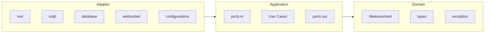
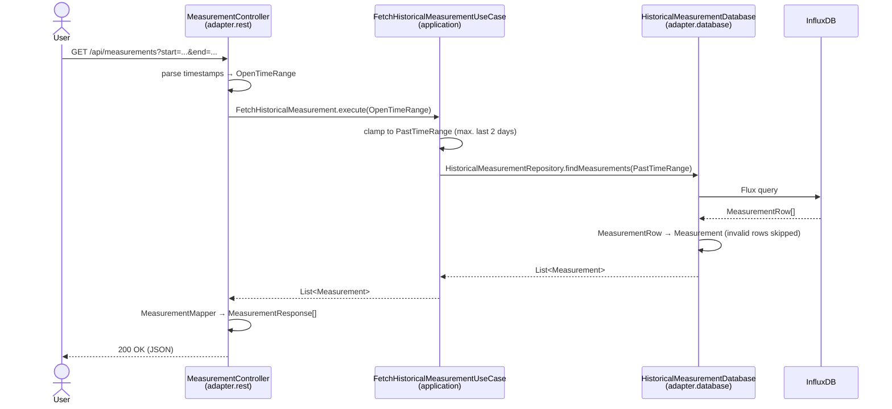
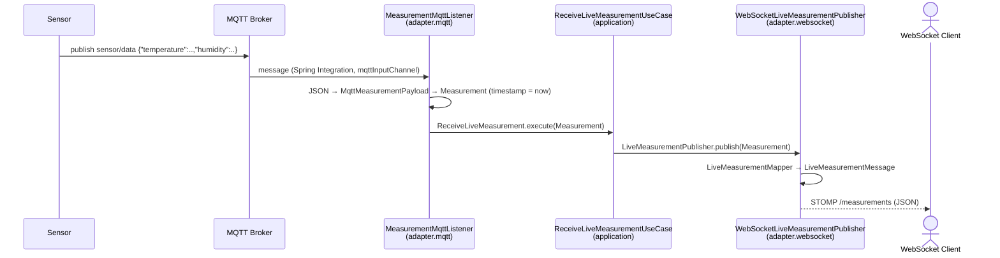

# Backend

Spring Boot (Java 25, Gradle) service that provides sensor measurements (temperature & humidity) to the frontend in two ways:

- **Historical data** via REST (`GET /api/measurements`), read from **InfluxDB**.
- **Live data** via WebSocket (STOMP over SockJS), received from an **MQTT** broker.

## Table of Contents

- [Architecture](#architecture)
- [Domain: Tiny Types](#domain-tiny-types)
- [Exception Handling](#exception-handling)
- [Data Flows](#data-flows)
- [API](#api)
- [Configuration](#configuration)
- [Build, Test & Run](#build-test--run)

## Architecture

The backend follows an **Onion Architecture** (a.k.a. Ports & Adapters / Hexagonal). Dependencies always point **inwards**:
adapters depend on the application layer, the application layer depends on the domain, and the domain depends on nothing.



| Layer | Package | Responsibility |
|-------|---------|----------------|
| **Domain** | `domain` | Core model (`Measurement`), tiny types (`Temperature`, `Humidity`, `OpenTimeRange`, `PastTimeRange`) and exceptions. No framework dependencies. |
| **Application** | `application` | Use cases. `ports.in` are the interfaces the adapters call (driving side), `ports.out` are the interfaces the use cases need from the outside world (driven side). |
| **Adapter** | `adapter` | Technical details: REST controllers, MQTT listener, InfluxDB repository, WebSocket publisher and Spring configuration. Each adapter has its own DTOs and mappers so that no external format leaks into the inner layers. |

### Ports

| Port | Type | Implemented by | Used by |
|------|------|----------------|---------|
| `FetchHistoricalMeasurement` | in | `FetchHistoricalMeasurementUseCase` | `MeasurementController` |
| `ReceiveLiveMeasurement` | in | `ReceiveLiveMeasurementUseCase` | `MeasurementMqttListener` |
| `HistoricalMeasurementRepository` | out | `HistoricalMeasurementDatabase` (InfluxDB) | `FetchHistoricalMeasurementUseCase` |
| `LiveMeasurementPublisher` | out | `WebSocketLiveMeasurementPublisher` | `ReceiveLiveMeasurementUseCase` |

### Architecture Enforcement

The rules are enforced automatically with [ArchUnit](https://www.archunit.org/) in `ArchitectureTest`:

- The onion architecture (domain → application → adapter dependency direction) must not be violated.
- All classes in `domain` (except `domain.exception`) must be Java `record`s (or enums), i.e. immutable value objects.

## Domain: Tiny Types

Instead of passing around primitive `double`s or `Instant`s, the domain uses **tiny types** (small, immutable records) that
**validate themselves in their constructor**. An invalid instance can therefore never exist.

| Type | Rule | Exception on violation |
|------|------|------------------------|
| `Temperature` | `-40 <= value <= 100` (°C) | `SystemException` |
| `Humidity` | `0 <= value <= 100` (%) | `SystemException` |
| `Measurement` | `timestamp` required; at least one of `temperature` / `humidity` required | `SystemException` |
| `OpenTimeRange` | `start` and `end` optional; if both given, `start <= end` | `ApplicationException` |
| `PastTimeRange` | `start` and `end` required, both in the past, `start <= end` | `ApplicationException` |

`OpenTimeRange` represents what the user requested, whereas `PastTimeRange` is the sanitized range that is actually
queried against the database (see [Flow 1](#flow-1-historical-measurements-rest)).

## Exception Handling

There are two exception types in `domain.exception`, both unchecked (`RuntimeException`):

| Exception | Meaning | Who can fix it? | HTTP status range |
|-----------|---------|-----------------|-------------------|
| `ApplicationException` | **User input error.** The request contains invalid data (e.g. a malformed timestamp, `start` after `end`). | The **user**, by sending valid data. | **4xx** (400 – 499) |
| `SystemException` | **Server-side error.** Something is wrong inside the system or with data coming from a technical source (e.g. an out-of-range sensor value, a measurement without timestamp). | Not the user, only the **operator / developer**. | **5xx** (500 – 599) |

Rule of thumb: if the user could have avoided the error by entering something different, throw an `ApplicationException`;
otherwise throw a `SystemException`.

> **Note:** There is currently no global exception handler (`@RestControllerAdvice`) that translates these exceptions into
> the corresponding HTTP status codes, so Spring falls back to its default error handling. When adding one, map
> `ApplicationException` to a 4xx status (e.g. `400 Bad Request`) and `SystemException` to a 5xx status
> (e.g. `500 Internal Server Error`).

Outside of HTTP, invalid data is handled gracefully:

- **MQTT:** messages that cannot be parsed or fail domain validation (`SystemException`) are logged as a warning and dropped.
- **InfluxDB:** rows that cannot be converted into a valid `Measurement` are skipped.

## Data Flows

### Flow 1: Historical Measurements (REST)

The user (frontend) requests historical data via `GET /api/measurements`.



1. `MeasurementController` parses the optional `start` / `end` query parameters (ISO-8601, e.g. `2026-10-16T10:00:00Z`)
   into an `OpenTimeRange`. Invalid timestamps result in an `ApplicationException`.
2. It calls the in-port `FetchHistoricalMeasurement`, implemented by `FetchHistoricalMeasurementUseCase`.
3. The use case converts the `OpenTimeRange` into a `PastTimeRange`:
   - missing or older than 2 days `start` → `now - 2 days`
   - missing or future `end` → `now`
4. The use case calls the out-port `HistoricalMeasurementRepository`, implemented by the InfluxDB adapter
   `HistoricalMeasurementDatabase`. It builds a Flux query (measurement `mqtt_consumer`, fields `temperature` and
   `humidity`, pivoted by time and sorted ascending) and maps each `MeasurementRow` to a domain `Measurement`.
5. Back in the controller, `MeasurementMapper` maps the domain objects to `MeasurementResponse` DTOs, which are returned as JSON.

### Flow 2: Live Measurements (MQTT → WebSocket)

The backend subscribes to an MQTT topic. Each incoming message is forwarded to all connected WebSocket clients.



1. `MqttConfig` sets up a Spring Integration `MqttPahoMessageDrivenChannelAdapter` that subscribes to the configured
   topic (`sensor/data`, QoS 1) and pushes every message into the `mqttInputChannel`.
2. `MeasurementMqttListener` (`@ServiceActivator`) parses the JSON payload into a `MqttMeasurementPayload`, and
   `MqttMeasurementMapper` converts it into a domain `Measurement`. The timestamp is the time of reception (from the
   injected `Clock`), since the payload contains none. Invalid messages are logged and dropped.
3. The listener calls the in-port `ReceiveLiveMeasurement`, implemented by `ReceiveLiveMeasurementUseCase`.
4. The use case calls the out-port `LiveMeasurementPublisher`, implemented by `WebSocketLiveMeasurementPublisher`.
5. The publisher maps the measurement to a `LiveMeasurementMessage` and sends it via `SimpMessagingTemplate` to the
   STOMP topic `/measurements`.

> Persisting MQTT data to InfluxDB is **not** done by this backend; it is written by **Telegraf** (measurement name
> `mqtt_consumer`). See the root `docker-compose.yml`.

## API

| Type | Endpoint | Description |
|------|----------|-------------|
| REST | `GET /api/health` | Health check, returns `Healthy`. Also used by the Docker `HEALTHCHECK`. |
| REST | `GET /api/measurements?start=<ISO-8601>&end=<ISO-8601>` | Historical measurements. Both parameters optional; range is limited to the last 2 days. |
| WebSocket | `/ws` (SockJS), subscribe to `/measurements` | Live measurements via STOMP. |

Example response / message (`MeasurementResponse` and `LiveMeasurementMessage` share the same shape):

```json
{
  "timestamp": "2026-10-16T17:34:06Z",
  "temperature": 21.5,
  "humidity": 45.2
}
```

`temperature` or `humidity` may be `null` if only one of them was measured.

Sample requests can be found in `requests/`:

- `measurements.http` – REST request for IntelliJ / VS Code REST clients.
- `live-client.html` – small browser page that connects to the WebSocket and logs incoming live data.

## Configuration

Configured in `src/main/resources/application.properties`; the following values can be overridden via environment variables:

| Environment variable | Default | Description |
|----------------------|---------|-------------|
| `MQTT_BROKER_URL` | `tcp://localhost:1883` | MQTT broker URL |
| `MQTT_USERNAME` | `iot_user` | MQTT username |
| `MQTT_PASSWORD` | – | MQTT password |
| `INFLUXDB_URL` | `http://localhost:8086` | InfluxDB URL |
| `INFLUXDB_TOKEN` | – | InfluxDB auth token |

Fixed values: MQTT topic `sensor/data`, InfluxDB org `study_org`, bucket `study_project`.

A `Clock` bean (`ClockConfig`, UTC) is injected wherever the current time is needed, which keeps time-dependent logic testable.

## Build, Test & Run

```powershell
# Run tests (unit tests + ArchUnit architecture rules)
.\gradlew test

# Run locally (requires a running MQTT broker and InfluxDB, e.g. via the root docker-compose.yml)
.\gradlew bootRun

# Build executable JAR
.\gradlew bootJar
```

### Docker

The `Dockerfile` uses a multi-stage build:

1. **Builder** (`eclipse-temurin:25-jdk-alpine`): builds the JAR, extracts it into Spring Boot layers and creates a minimal
   custom JRE with `jdeps` + `jlink`.
2. **Runtime** (`alpine`): contains only the custom JRE and the application layers, runs as non-root user and exposes port `8080`
   with a health check against `/api/health`.
